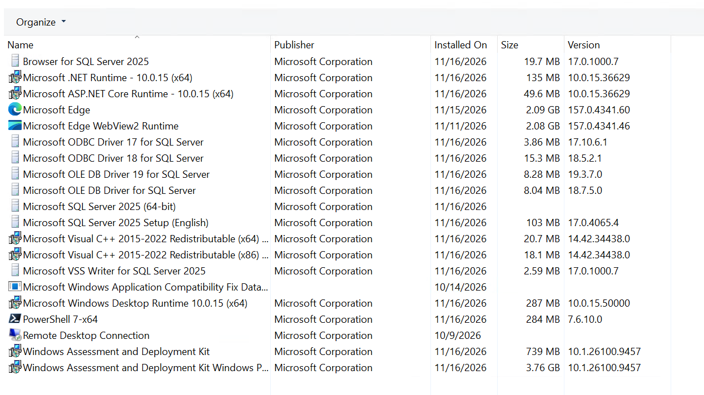
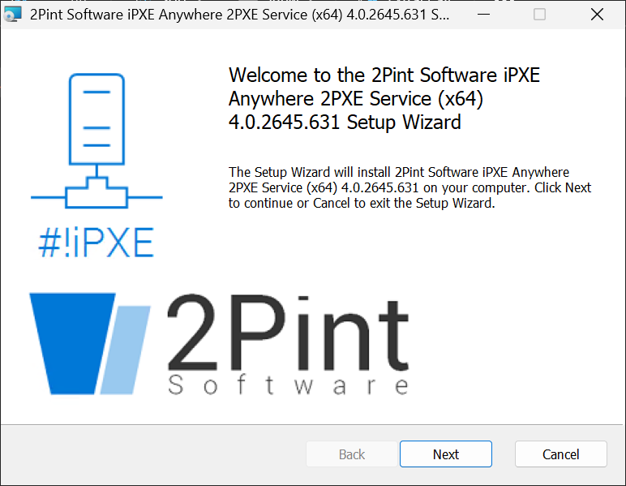
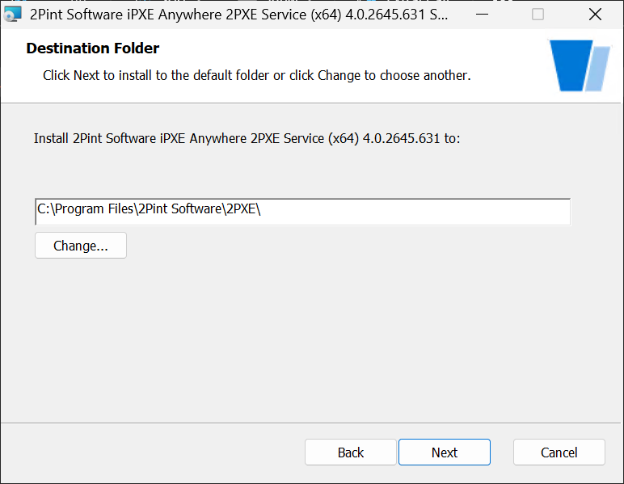
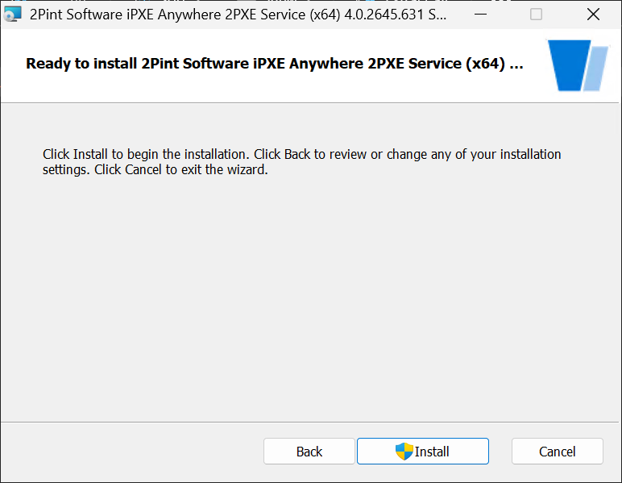
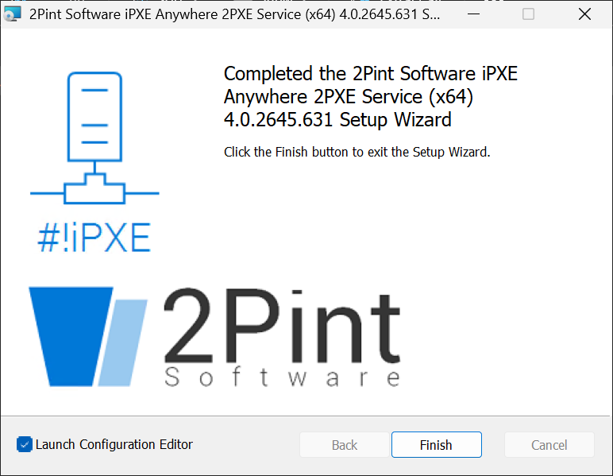

# DeployR Lab Setup Walkthrough

This walkthrough describes a bare-bones lab setup for DeployR and its supporting 2Pint products. It is intended for readers who are new to 2PXE, StifleR, and DeployR. Use the linked product documentation for the full installer options and configuration details.

## Test Machine and Network Setup

Here is my test machine and network setup for this walkthrough.

| Setting | Value |
| --- | --- |
| Server name | `DR` |
| Domain membership | Workgroup |
| DNS name | `DR.2P.GARYTOWN.COM` |
| Memory | 4 GB RAM |
| System drive | `C:` 120 GB |
| Data drive | `D:` 140 GB |

These are bare-bones lab specifications, not production recommendations. Allocate more memory and storage for a larger or production deployment.

The server is named `DR` and remains in a workgroup. DNS should resolve `DR.2P.GARYTOWN.COM` to the server's address.

> Screenshot to add: Test machine and network setup.

The products and versions covered in this walkthrough are:

| Product | Version for this walkthrough | Setup guide |
| --- | --- | --- |
| 2PXE Server | 4.0.x | [Manual Installation - 2PXE Server 4.0](https://documentation.2pintsoftware.com/2pxe-server/4.0/installation/installation-and-configuration) |
| iPXE WebService add-on | 4.0.x | [iPXE Anywhere Web Service installation](https://documentation.2pintsoftware.com/ipxe-ws/4.0/installation/ipxe-anywhere-web-service-install) |
| StifleR Server | 3.1.x | [StifleR Server installation](https://documentation.2pintsoftware.com/stifler/setup/installation/stifler-server-installation) |
| StifleR Dashboard | 3.1.x | [StifleR Dashboard installation](https://documentation.2pintsoftware.com/stifler/setup/installation/stifler-dashboard-installation) |
| DeployR | 1.4.x | [DeployR Server installation](https://documentation.2pintsoftware.com/deployr/deployr-enterprise/deployr-server-installation) |

This walkthrough installs the iPXE WebService add-on after 2PXE Server. Confirm product compatibility and supported upgrade paths in the official documentation before changing versions.

Software is available from [releases.2pintsoftware.com](https://releases.2pintsoftware.com/)

## Setup Checklist

- [ ] PowerShell 7.6.x installed
- [ ] .NET 10.x runtimes installed
- [ ] Windows BranchCache feature enabled
- [ ] Windows ADK and WinPE add-on installed
- [ ] If installing iPXE WebService: SQL Express and its cumulative update installed, server rebooted, SQL configured, and Management Studio installed
- [ ] Server is named `DR`, remains in a workgroup, and has the documented disk layout
- [ ] `DR.2P.GARYTOWN.COM` resolves to the server
- [ ] 2PXE Server 4.0.x installed and verified
- [ ] iPXE WebService add-on 4.0.x installed and verified
- [ ] StifleR Server 3.1.x installed
- [ ] StifleR Dashboard 3.1.x installed and connected to StifleR Server
- [ ] DeployR 1.4.x installed and verified

## 1. Install the Prerequisites

The following prerequisites are installed using the scripts linked below. Run them in an elevated PowerShell session on the server, and review each script and its output before continuing.

### PowerShell 7.6.x

Run the [PowerShell 7.6.x installer script](https://github.com/2pintsoftware/2Pint-DeployR/blob/main/Installs/Pre-Reqs/Install-PowerShell76X.ps1).

### .NET 10.x Runtimes

Run the [.NET 10.x runtimes installer script](https://github.com/2pintsoftware/2Pint-DeployR/blob/main/Installs/Pre-Reqs/Install-DotNetRuntimes100X.ps1).

### Windows BranchCache Feature

Run the [BranchCache prerequisite script](https://github.com/2pintsoftware/2Pint-DeployR/blob/main/Installs/Pre-Reqs/Install-WinFeatures-BranchCache-Required.ps1).

### Windows ADK and WinPE Add-on

Run the [Windows ADK installer script](https://github.com/2pintsoftware/2Pint-DeployR/blob/main/Installs/Pre-Reqs/Install-WindowsADK.ps1), followed by the [Windows ADK WinPE add-on installer script](https://github.com/2pintsoftware/2Pint-DeployR/blob/main/Installs/Pre-Reqs/Install-WindowsADKWinPE.ps1).

### SQL Express (required only for iPXE WebService)

SQL Express is only needed if you are installing the iPXE WebService add-on. Skip this subsection if you are not installing the add-on. Complete these steps in order:

1. Install [SQL Express](https://github.com/2pintsoftware/2Pint-DeployR/blob/main/Installs/Pre-Reqs/Install-SQLExpress2025.ps1).
2. Install the [SQL Server 2025 cumulative update](https://github.com/2pintsoftware/2Pint-DeployR/blob/main/Installs/Pre-Reqs/Install-SQL2025CU.ps1).
3. Reboot the server after the cumulative update completes.
4. Run the [SQL Express configuration script](https://github.com/2pintsoftware/2Pint-DeployR/blob/main/Installs/Pre-Reqs/Configure-SQLExpress.ps1).
5. Install [SQL Server Management Studio 22](https://github.com/2pintsoftware/2Pint-DeployR/blob/main/Installs/Pre-Reqs/Install-SMSS22.ps1).

> Screenshot to show Pre-reqs complete, skipped SSMS for this server as it's only needed to look at SQL databases, can be used from other endpoints.

## 2. Install 2PXE Server 4.0.x

Install and configure 2PXE by following the [official 2PXE manual installation guide](https://documentation.2pintsoftware.com/2pxe-server/4.0/installation/installation-and-configuration).

During installation, use the certificate generated by 2PXE as described in its setup flow. Record where the certificate is stored and follow the product documentation for any trust or certificate-binding steps needed by your environment.

2PXE installation screenshots. Select an image to open it at full size.

| 2PXE setup 1 | 2PXE setup 2 | 2PXE setup 3 |
| --- | --- | --- |
|  |  |  |
|  |  |  |

After installation, verify the 2PXE service and configuration using the checks in the official guide before proceeding.

## 3. Install the iPXE WebService add-on 4.0.x

After 2PXE Server is installed and verified, install the iPXE WebService add-on by following the [official iPXE Anywhere Web Service installation guide](https://documentation.2pintsoftware.com/ipxe-ws/4.0/installation/ipxe-anywhere-web-service-install).

> Screenshot to add: iPXE WebService add-on installation and configuration.

Use the guide's verification steps to confirm the WebService is installed and operating before proceeding.

## 4. Install StifleR Server 3.1.x

Follow the [official StifleR Server installation guide](https://documentation.2pintsoftware.com/stifler/setup/installation/stifler-server-installation) to install and configure the StifleR Server component.

> Screenshot to add: StifleR Server installation and configuration.

Use the guide's verification steps to confirm the server component is installed and operating before installing the dashboard.

## 5. Install StifleR Dashboard 3.1.x

Follow the [official StifleR Dashboard installation guide](https://documentation.2pintsoftware.com/stifler/setup/installation/stifler-dashboard-installation) to install and configure the dashboard.

> Screenshot to add: StifleR Dashboard installation and first successful access.

Use the dashboard guide to validate access and its connection to the StifleR Server.

## 6. Install DeployR 1.4.x

Follow the [official DeployR Server installation guide](https://documentation.2pintsoftware.com/deployr/deployr-enterprise/deployr-server-installation) to install and configure DeployR.

> Screenshot to add: DeployR Server installation and configuration.

Complete the verification steps in the guide and confirm the DeployR interface is reachable using the configured server name and address.

## Troubleshooting Pointers

- If a setup page or service is unreachable, first confirm that the DNS name resolves to the expected server and that you are using the address and port configured during installation.
- If a browser or client reports a certificate warning, follow the 2PXE and product documentation for the generated certificate's trust and binding requirements. Do not replace it with a different certificate unless your environment requires that configuration.
- If an installer or verification step fails, capture the exact error and consult the troubleshooting section for that product in its official setup guide before continuing.

## References

- [2PXE Server 4.0 installation and configuration](https://documentation.2pintsoftware.com/2pxe-server/4.0/installation/installation-and-configuration)
- [iPXE Anywhere Web Service installation](https://documentation.2pintsoftware.com/ipxe-ws/4.0/installation/ipxe-anywhere-web-service-install)
- [StifleR Server installation](https://documentation.2pintsoftware.com/stifler/setup/installation/stifler-server-installation)
- [StifleR Dashboard installation](https://documentation.2pintsoftware.com/stifler/setup/installation/stifler-dashboard-installation)
- [DeployR Server installation](https://documentation.2pintsoftware.com/deployr/deployr-enterprise/deployr-server-installation)
- [PowerShell 7.6.x prerequisite script](https://github.com/2pintsoftware/2Pint-DeployR/blob/main/Installs/Pre-Reqs/Install-PowerShell76X.ps1)
- [.NET 10.x runtimes prerequisite script](https://github.com/2pintsoftware/2Pint-DeployR/blob/main/Installs/Pre-Reqs/Install-DotNetRuntimes100X.ps1)
- [BranchCache prerequisite script](https://github.com/2pintsoftware/2Pint-DeployR/blob/main/Installs/Pre-Reqs/Install-WinFeatures-BranchCache-Required.ps1)
- [Windows ADK prerequisite script](https://github.com/2pintsoftware/2Pint-DeployR/blob/main/Installs/Pre-Reqs/Install-WindowsADK.ps1)
- [Windows ADK WinPE add-on prerequisite script](https://github.com/2pintsoftware/2Pint-DeployR/blob/main/Installs/Pre-Reqs/Install-WindowsADKWinPE.ps1)
- [SQL Express prerequisite script](https://github.com/2pintsoftware/2Pint-DeployR/blob/main/Installs/Pre-Reqs/Install-SQLExpress2025.ps1)
- [SQL Server 2025 cumulative update script](https://github.com/2pintsoftware/2Pint-DeployR/blob/main/Installs/Pre-Reqs/Install-SQL2025CU.ps1)
- [SQL Express configuration script](https://github.com/2pintsoftware/2Pint-DeployR/blob/main/Installs/Pre-Reqs/Configure-SQLExpress.ps1)
- [SQL Server Management Studio 22 installer script](https://github.com/2pintsoftware/2Pint-DeployR/blob/main/Installs/Pre-Reqs/Install-SMSS22.ps1)
